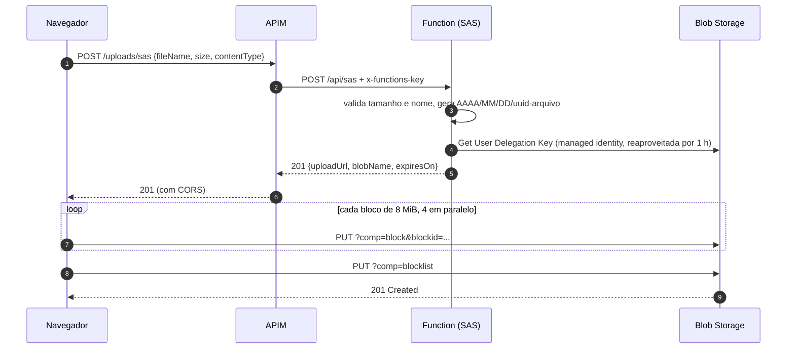

<p align="center">
  <a href="https://github.com/rodrigoaraujorosa/azure-storage-account-lab/actions/workflows/ci.yml"></a>
  
  <a href="LICENSE"></a>
  
  
  
  
  
  <a href="https://www.conventionalcommits.org/pt-br/v1.0.0/"></a>
</p>

# Azure Storage Account — lab

Upload de arquivos de 100 a 400 MB feito pelo navegador **direto no Azure Blob Storage**, com uma SAS emitida por um microserviço que fica atrás do APIM. O arquivo não passa pelo APIM, que não é feito para trafegar arquivos desse tamanho; pelo APIM passa só o pedido da SAS, um JSON pequeno.

## 🎯 O que validar

- [ ] O frontend obtém a SAS pelo caminho **Frontend → APIM → microserviço** em menos de 1 s.
- [ ] O navegador envia 100–400 MB **direto ao Storage** em blocos (Put Block + Put Block List), com progresso e nova tentativa por bloco, sem nenhum byte do arquivo passar pelo APIM.
- [ ] A SAS é uma **user delegation SAS** assinada com a managed identity da Function: a conta de upload fica com **shared key desabilitada** e não existe chave da conta em lugar nenhum.
- [ ] A SAS vale para **um único blob**, só com `create` + `write`, por 15 minutos: não lê, não lista, não apaga e não serve para outro nome.
- [ ] O CORS da conta de upload aceita só a origem do frontend, e o do APIM também.
- [ ] Qual combinação de tamanho de bloco e paralelismo dá a melhor vazão, e quanto tempo levam 100, 200 e 400 MB.
- [ ] O que acontece quando a SAS expira no meio do upload.
- [ ] Limite de tamanho: o microserviço recusa o pedido acima de `MAX_UPLOAD_MB`, mas a SAS em si não limita o tamanho. Confirmar e registrar a mitigação.

## 🏗️ Arquitetura




| Recurso | Nome | Papel |
| --- | --- | --- |
| Resource group | `rg-azure-storage-account-lab` | Tudo do lab; apagar o grupo apaga o lab |
| Storage (upload) | `stasalup<sufixo>` | Contêiner privado `uploads`, sem shared key, CORS só para o frontend, soft delete de 7 dias |
| Storage (frontend) | `stasalweb<sufixo>` | Static website com o `web/` |
| Storage (Function) | `stasalfn<sufixo>` | Storage interno da Function App |
| Function App | `func-azure-storage-account-lab-<sufixo>` | Microserviço de SAS, Python 3.12, Flex Consumption, managed identity |
| API Management | `apim-azure-storage-account-lab-<sufixo>` | Tier Consumption, API `uploads` com CORS e a function key num named value secreto |

Todos levam a tag `repo=azure-storage-account-lab`. Os nomes de Storage não aceitam hífen nem mais de 24 caracteres; `stasal` abrevia o nome do repositório.

**Decisões do lab**

- **User delegation SAS em vez de SAS com chave da conta:** é assinada com credenciais do Entra ID, pode ser revogada revogando a delegation key, e permite desligar a shared key da conta.
- **Papéis mínimos para a Function:** *Storage Blob Delegator* na conta (gerar a delegation key é uma ação da conta) e *Storage Blob Data Contributor* só no contêiner `uploads`. A SAS nunca concede mais do que a identidade tem.
- **Blocos em vez de um único PUT:** um Put Blob aceitaria 400 MB de uma vez, mas uma falha de rede perderia tudo. Em blocos há progresso, paralelismo e nova tentativa só do bloco que falhou.
- **APIM sem subscription key:** a chave ficaria exposta no JavaScript do navegador. Em produção, a autenticação seria um token do Entra ID validado com `validate-jwt`.

## 🚀 Como rodar

### Pré-requisitos

- Assinatura Azure com permissão de criar recursos e **atribuir papéis** (Owner ou User Access Administrator no resource group).
- **Azure Cloud Shell (Bash)**, o caminho mais simples: já tem `az`, `jq`, `zip` e `curl` e já está logado. Localmente, também funciona com Git Bash, WSL, Linux ou macOS, com [Azure CLI](https://learn.microsoft.com/cli/azure/install-azure-cli), `jq` e `zip` instalados e `az login` feito.

### Publicar com o Azure CLI

```bash
git clone https://github.com/rodrigoaraujorosa/azure-storage-account-lab.git
cd azure-storage-account-lab
cp .env.example .env   # preencha APIM_PUBLISHER_NAME e APIM_PUBLISHER_EMAIL

bash scripts/deploy.sh # ~10 min, a maior parte é o APIM
```

O `deploy.sh` roda as etapas em ordem, e cada uma pode ser rodada de novo sozinha:

| Script | O que faz |
| --- | --- |
| `01-resource-group.sh` | Cria o resource group com a tag `repo` |
| `02-storage.sh` | Conta do frontend (static website) e conta de upload (sem shared key), contêiner, CORS e soft delete |
| `03-function.sh` | Function App Flex Consumption, managed identity, papéis, configurações e deploy do código |
| `04-apim.sh` | APIM Consumption, named value com a function key, API, operações e policy |
| `05-frontend.sh` | Gera `web/config.js` com a URL do APIM e publica o `web/` no static website |

No fim, o script mostra a URL do frontend.

> Se a região padrão (`brazilsouth`) não tiver Flex Consumption, o `03-function.sh` para e lista as regiões disponíveis. Defina `FUNC_LOCATION` no `.env` e rode de novo.
>
> Os papéis atribuídos levam alguns minutos para valer. Se a primeira SAS falhar com erro 500 e `AuthorizationPermissionMismatch` no log da Function, espere e tente de novo.

### Publicar pelo Portal Azure

O passo a passo, com os mesmos recursos e configurações, está em **[docs/portal.md](docs/portal.md)**.

### Testar

1. **Pelo terminal (sem navegador):** pede a SAS, envia 1 MiB, confirma que a SAS não lê e que o limite de tamanho é respeitado.

   ```bash
   bash scripts/smoke-test.sh
   ```

2. **Pelo navegador:** gere arquivos de teste em `data/local/` (ignorada pelo git), abra a URL do frontend e envie.

   ```bash
   mkdir -p data/local
   for mb in 100 200 400; do head -c "${mb}M" /dev/urandom > "data/local/teste-${mb}mb.bin"; done
   # Windows (cmd/PowerShell): fsutil file createnew data\local\teste-400mb.bin 419430400
   ```

   A tela mostra o tempo da SAS, o tempo de upload, a vazão e o nome do blob. Mude o tamanho do bloco e o paralelismo para comparar.

3. **Conferir o blob** (você recebeu *Storage Blob Data Contributor* no contêiner no `02-storage.sh`):

   ```bash
   source .env
   az storage blob list --auth-mode login --account-name "stasalup$SUFFIX" -c uploads \
     --query "[].{nome:name, MiB:properties.contentLength}" -o table
   ```

### Rodar o frontend e o microserviço localmente (opcional)

```bash
# Frontend em http://localhost:8080 (origem já liberada no CORS do Storage e do APIM)
cp web/config.example.js web/config.js   # ajuste apiBaseUrl
python -m http.server 8080 -d web

# Microserviço (Azure Functions Core Tools + Azurite ou uma conta real em AzureWebJobsStorage)
cd src/sas_service
cp local.settings.example.json local.settings.json   # ajuste STORAGE_ACCOUNT_URL
pip install -r requirements.txt && func start
```

Localmente, a SAS é assinada com o seu `az login`, então você precisa dos papéis *Storage Blob Delegator* na conta e *Storage Blob Data Contributor* no contêiner.

### Testes e lint

```bash
uv run --group dev pytest
uv run --group dev ruff check . && uv run --group dev ruff format --check .
```

## ✅ Resultado

> A preencher ao final do lab.

| Arquivo | Bloco | Paralelos | SAS (APIM) | Upload | Vazão |
| --- | --- | --- | --- | --- | --- |
| 100 MB | 8 MiB | 4 | | | |
| 200 MB | 8 MiB | 4 | | | |
| 400 MB | 8 MiB | 4 | | | |
| 400 MB | 16 MiB | 8 | | | |

**O que funcionou:**

**O que não funcionou:**

**Aprendizados:**

## 💸 Custos e limpeza

Todos os serviços estão em tiers de consumo: APIM Consumption e Functions Flex Consumption têm cota gratuita mensal, e o Storage cobra por GB armazenado e por operação. O custo esperado do lab é de centavos. Para ver o custo real: *Cost Management → Cost analysis*, filtrando pela tag `repo = azure-storage-account-lab`.

> Custo total: a registrar.
> Recursos apagados em: a registrar.

Para apagar tudo (pede confirmação e também purga o APIM do soft delete, liberando o nome):

```bash
bash scripts/cleanup.sh
```

## 📁 Estrutura

```
├── src/sas_service/         # Function App (Python): function_app.py, sas_issuer.py, sas_logic.py
├── web/                     # frontend estático (HTML + JS sem framework)
├── infra/apim/              # policy da API no APIM
├── scripts/                 # Azure CLI: deploy, smoke test e limpeza
├── tests/unit/              # pytest das regras do microserviço
├── docs/portal.md           # passo a passo pelo Portal Azure
└── data/local/              # arquivos de teste (ignorados pelo git)
```

## 📄 Licença

[MIT](LICENSE) © Rodrigo de Araujo Rosa
