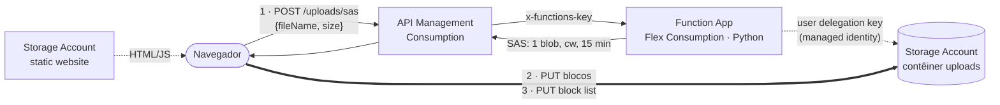
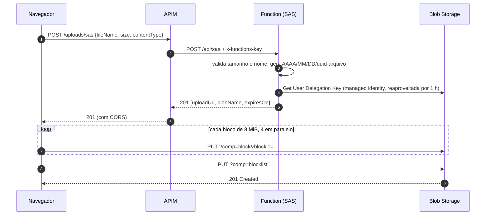

<p align="center">
  <a href="https://github.com/rodrigoaraujorosa/azure-storage-account-lab/actions/workflows/ci.yml"></a>
  
  <a href="LICENSE"></a>
  
  
  
  
  
  <a href="https://www.conventionalcommits.org/pt-br/v1.0.0/"></a>
</p>

# Azure Storage Account — lab

Upload de arquivos de 100 a 400 MB feito pelo navegador **direto no Azure Blob Storage**, com uma SAS emitida por um microserviço que fica atrás do APIM. O arquivo não passa pelo APIM, que não é feito para trafegar arquivos desse tamanho; pelo APIM passa só o pedido da SAS, um JSON pequeno.

## 🎯 O que validar

- [x] O frontend obtém a SAS pelo caminho **Frontend → APIM → microserviço** em menos de 1 s. *Com a Function aquecida, sim; depois de alguns minutos parada, o cold start leva 0,9–1,9 s. Ver [Resultado](#-resultado).*
- [x] O navegador envia 100–400 MB **direto ao Storage** em blocos (Put Block + Put Block List), com progresso e nova tentativa por bloco, sem nenhum byte do arquivo passar pelo APIM.
- [x] A SAS é uma **user delegation SAS** assinada com a managed identity da Function: a conta de upload fica com **shared key desabilitada** e não existe chave da conta em lugar nenhum.
- [ ] A SAS vale para **um único blob**, só com `create` + `write`, por 15 minutos: não lê, não lista, não apaga e não serve para outro nome. *Leitura negada (403) confirmada; exclusão e outros nomes ficam para o teste no Postman.*
- [x] O CORS da conta de upload aceita só a origem do frontend, e o do APIM também.
- [ ] Qual combinação de tamanho de bloco e paralelismo dá a melhor vazão, e quanto tempo levam 100, 200 e 400 MB. *Tempos medidos; a comparação entre configurações ainda falta.*
- [ ] O que acontece quando a SAS expira no meio do upload.
- [ ] Limite de tamanho: o microserviço recusa o pedido acima de `MAX_UPLOAD_MB`, mas a SAS em si não limita o tamanho. Confirmar e registrar a mitigação.

## 🏗️ Arquitetura





| Recurso | Nome | Papel |
| --- | --- | --- |
| Resource group | `rg-azure-storage-account-lab` | Tudo do lab; apagar o grupo apaga o lab |
| Storage (upload) | `stasalup<sufixo>` | Contêiner privado `uploads`, sem shared key, CORS só para o frontend, soft delete de 7 dias |
| Storage (frontend) | `stasalweb<sufixo>` | Static website com o `web/` |
| Storage (Function) | `stasalfn<sufixo>` | Storage interno da Function App |
| Function App | `func-azure-storage-account-lab-<sufixo>` | Microserviço de SAS, Python 3.12, Flex Consumption, managed identity |
| API Management | `apim-azure-storage-account-lab-<sufixo>` | Tier Consumption, API `uploads` com CORS e a function key num named value secreto |

Todos levam a tag `repo=azure-storage-account-lab`. Os nomes de Storage não aceitam hífen nem mais de 24 caracteres; `stasal` abrevia o nome do repositório.

**Decisões do lab**

- **User delegation SAS em vez de SAS com chave da conta:** é assinada com credenciais do Entra ID, pode ser revogada revogando a delegation key, e permite desligar a shared key da conta.
- **Papéis mínimos para a Function:** *Storage Blob Delegator* na conta (gerar a delegation key é uma ação da conta) e *Storage Blob Data Contributor* só no contêiner `uploads`. A SAS nunca concede mais do que a identidade tem.
- **Blocos em vez de um único PUT:** um Put Blob aceitaria 400 MB de uma vez, mas uma falha de rede perderia tudo. Em blocos há progresso, paralelismo e nova tentativa só do bloco que falhou.
- **APIM sem subscription key:** a chave ficaria exposta no JavaScript do navegador. Em produção, a autenticação seria um token do Entra ID validado com `validate-jwt`.

### 🔁 Do lab para o cenário real (microserviço Node no AKS)

No cenário real, quem emite a SAS é um microserviço em Node.js rodando no AKS. Neste lab, a **Function faz o papel desse microserviço**, com o mesmo contrato: `POST /sas` recebe `{fileName, size, contentType}` e devolve `{uploadUrl, blobName, expiresOn}`. Para o frontend, o APIM e o Storage, não faz diferença quem está atrás.

| Aspecto | No lab (Function) | No cenário real (Node no AKS) |
| --- | --- | --- |
| Identidade que assina a SAS | Managed identity da Function App | **Workload Identity** do AKS: a service account do pod federada com uma managed identity do Entra ID |
| Papéis | *Storage Blob Delegator* na conta + *Storage Blob Data Contributor* no contêiner | Os mesmos, atribuídos à identidade do pod |
| SDK | `azure-storage-blob` (Python) | `@azure/storage-blob` + `@azure/identity`: `getUserDelegationKey()` e `generateBlobSASQueryParameters()` com `DefaultAzureCredential` |
| APIM → backend | Function key num named value secreto | Ingress do AKS, de preferência em rede privada (APIM integrado à VNet), e/ou token do Entra ID ou mTLS |
| Cold start | 0,9–1,9 s depois de alguns minutos sem uso | Não há: os pods ficam rodando |
| Cache da user delegation key | Em memória, por instância | O mesmo; com várias réplicas, cada pod tem a sua chave, sem problema |

O que o lab validou continua valendo para o AKS: o fluxo, a SAS de um único blob só com `create` + `write`, a conta sem shared key, o CORS e o upload em blocos. O cold start é uma limitação da Function e não se aplica ao AKS.

## 🚀 Como rodar

### Pré-requisitos

- Assinatura Azure com permissão de criar recursos e **atribuir papéis** (Owner ou User Access Administrator no resource group).
- **Azure Cloud Shell (Bash)**, o caminho mais simples: já tem `az`, `jq`, `zip` e `curl` e já está logado. Localmente, também funciona com Git Bash, WSL, Linux ou macOS, com [Azure CLI](https://learn.microsoft.com/cli/azure/install-azure-cli), `jq` e `zip` instalados e `az login` feito.
- **Git Bash no Windows:** testado. Os scripts convertem os caminhos de arquivo para o formato do Windows e removem o `\r` da saída do `az`. Se o `az` não for encontrado logo depois de instalar, feche e reabra o VS Code ou o terminal.
- **Assinaturas com regiões restritas** (ex.: Azure for Students): veja as regiões permitidas com `az policy assignment list --query "[].parameters.listOfAllowedLocations.value"` e escolha uma delas em `AZURE_LOCATION`. Na primeira execução, o `01-resource-group.sh` registra os resource providers que faltam.

### Publicar com o Azure CLI

```bash
git clone https://github.com/rodrigoaraujorosa/azure-storage-account-lab.git
cd azure-storage-account-lab
cp .env.example .env   # preencha APIM_PUBLISHER_NAME e APIM_PUBLISHER_EMAIL

bash scripts/deploy.sh # ~10 min, a maior parte é o APIM
```

O `deploy.sh` roda as etapas em ordem, e cada uma pode ser rodada de novo sozinha:

| Script | O que faz |
| --- | --- |
| `01-resource-group.sh` | Cria o resource group com a tag `repo` |
| `02-storage.sh` | Conta do frontend (static website) e conta de upload (sem shared key), contêiner, CORS e soft delete |
| `03-function.sh` | Function App Flex Consumption, managed identity, papéis, configurações e deploy do código |
| `04-apim.sh` | APIM Consumption, named value com a function key, API, operações e policy |
| `05-frontend.sh` | Gera `web/config.js` com a URL do APIM e publica o `web/` no static website |

No fim, o script mostra a URL do frontend.

> Se a região padrão (`brazilsouth`) não tiver Flex Consumption, o `03-function.sh` para e lista as regiões disponíveis. Defina `FUNC_LOCATION` no `.env` e rode de novo.
>
> Os papéis atribuídos levam alguns minutos para valer. Se a primeira SAS falhar com erro 500 e `AuthorizationPermissionMismatch` no log da Function, espere e tente de novo.

### Publicar pelo Portal Azure

O passo a passo, com os mesmos recursos e configurações, está em **[docs/portal.md](docs/portal.md)**.

### Testar

1. **Pelo terminal (sem navegador):** pede a SAS, envia 1 MiB, confirma que a SAS não lê e que o limite de tamanho é respeitado.

   ```bash
   bash scripts/smoke-test.sh
   ```

2. **Pelo navegador:** gere arquivos de teste em `data/local/` (ignorada pelo git), abra a URL do frontend e envie.

   ```bash
   mkdir -p data/local
   for mb in 100 200 400; do head -c "${mb}M" /dev/urandom > "data/local/teste-${mb}mb.bin"; done
   # Windows (cmd/PowerShell): fsutil file createnew data\local\teste-400mb.bin 419430400
   ```

   A tela mostra o tempo da SAS, o tempo de upload, a vazão e o nome do blob. Mude o tamanho do bloco e o paralelismo para comparar.

3. **Pelo Postman:** gere o environment com os endereços do seu deploy e importe os dois arquivos de `postman/` (*Import* no Postman).

   ```bash
   bash scripts/postman-env.sh
   ```

   | Pasta | O que testa |
   | --- | --- |
   | 1 · Pedir SAS | Frontend → APIM → Function: `201`, SAS de um blob, `sp=cw`, `spr=https`, user delegation, resposta em menos de 1 s |
   | 2 · Upload direto | Put Blob do arquivo inteiro (escolha o arquivo no *Body → binary*) e confirma que a SAS não lê nem apaga (`403`) |
   | 3 · Upload em blocos | Put Block × 2 + Put Block List: o mesmo mecanismo do frontend, com blocos pequenos |
   | 4 · Validações e segurança | Limite de tamanho (`400`), corpo inválido (`400`), Content-Type errado (`415`), Function sem chave (`401`), CORS no APIM e no Storage, e que a SAS **não** limita o tamanho enviado |

   Rode pasta por pasta (ou *Run collection*). Cada pasta pede a própria SAS no primeiro request. O Postman não divide o arquivo em blocos, então na pasta 2 o arquivo vai num único PUT; a vazão em blocos se mede pelo frontend.

4. **Conferir o blob** (você recebeu *Storage Blob Data Contributor* no contêiner no `02-storage.sh`):

   ```bash
   source .env
   az storage blob list --auth-mode login --account-name "stasalup$SUFFIX" -c uploads \
     --query "[].{nome:name, MiB:properties.contentLength}" -o table
   ```

### Rodar o frontend e o microserviço localmente (opcional)

```bash
# Frontend em http://localhost:8080 (origem já liberada no CORS do Storage e do APIM)
cp web/config.example.js web/config.js   # ajuste apiBaseUrl
python -m http.server 8080 -d web

# Microserviço (Azure Functions Core Tools + Azurite ou uma conta real em AzureWebJobsStorage)
cd src/sas_service
cp local.settings.example.json local.settings.json   # ajuste STORAGE_ACCOUNT_URL
pip install -r requirements.txt && func start
```

Localmente, a SAS é assinada com o seu `az login`, então você precisa dos papéis *Storage Blob Delegator* na conta e *Storage Blob Data Contributor* no contêiner.

### Testes e lint

```bash
uv run --group dev pytest
uv run --group dev ruff check . && uv run --group dev ruff format --check .
```

## ✅ Resultado

Execução de 17/11/2026 em `eastus2` (assinatura Azure for Students), com o frontend publicado no static website e o upload feito de uma conexão residencial no Brasil.

### Uploads pela interface web

| Arquivo | Blocos | SAS (Function) | Upload | Vazão |
| --- | --- | --- | --- | --- |
| 100 MiB | 8 MiB × 4 | 1.225 ms (cold start) | ~44 s | ~2,3 MiB/s |
| 200 MiB | 8 MiB × 4 | 14 ms | ~98 s | ~2,0 MiB/s |
| 400 MiB | 8 MiB × 4 | 896 ms (cold start) | ~234 s | ~1,7 MiB/s |
| 400 MiB | 8 MiB × 4 | 1.227 ms (cold start) | ~209 s | ~1,9 MiB/s |

Como foi medido: **SAS (Function)** é a duração da requisição no Application Insights, sem o tempo do APIM e da rede. **Upload** vai da emissão da SAS (log `SAS emitida`) até o commit do blob (`creationTime`), com precisão de ~1 s. Os quatro blobs chegaram com o tamanho exato do arquivo. Blocos: a configuração padrão da tela.

### Testes de segurança e integração

| Teste | Esperado | Obtido |
| --- | --- | --- |
| Pedido de SAS pelo APIM | 201 | ✅ 201 |
| Upload de 1 MiB com a SAS (Put Blob) | 201 | ✅ 201 |
| Ler o blob com a mesma SAS | 403 | ✅ 403 |
| Pedido acima de `MAX_UPLOAD_MB` | 400 | ✅ 400 |
| Conta de upload com `allowSharedKeyAccess` | `false` | ✅ `false` |
| Function chamada direto, sem a function key | 401 | ✅ 401 |
| Preflight no APIM com a origem do frontend | `Access-Control-Allow-Origin` | ✅ |
| Preflight no APIM com outra origem | sem `Access-Control-Allow-Origin` | ✅ |
| Preflight no Storage com a origem do frontend | 200 | ✅ 200 |
| Preflight no Storage com outra origem | 403 | ✅ 403 |

**O que funcionou**

- O fluxo completo: o APIM trafega só o JSON da SAS, e 100–400 MiB vão do navegador direto ao Storage, em blocos.
- User delegation SAS com a managed identity, numa conta com shared key desabilitada: não existe chave da conta no lab.
- Permissões mínimas: *Storage Blob Delegator* na conta e *Storage Blob Data Contributor* só no contêiner bastaram para emitir a SAS.
- A SAS emitida e não usada não deixa rastro: dois pedidos do smoke test que falharam antes do upload não criaram nenhum blob.

**O que não funcionou ou ficou abaixo do esperado**

- **Cold start da Function:** com a instância aquecida, a SAS sai em 9–14 ms; depois de 2–5 minutos sem uso, o Flex Consumption volta a zero e a primeira chamada leva 0,9–1,9 s. Para ficar sempre abaixo de 1 s, seria preciso configurar instâncias *always ready* no Flex Consumption, que têm custo fixo.
- **Vazão:** ficou em ~1,7–2,3 MiB/s (14–19 Mbit/s), provavelmente o limite de upload da conexão de origem, e não do Storage. A comparação entre tamanhos de bloco e paralelismo ainda falta.
- **Deploy no Git Bash do Windows:** `az`, `zip` e `curl` são executáveis Windows e não entendem caminhos `/c/...` quando a conversão do MSYS está desligada. Corrigido nos scripts com `cygpath -w`.
- **`az functionapp show` no Flex Consumption** (CLI 2.93) não traz `defaultHostName` no topo da resposta. Corrigido lendo o host do recurso ARM.

**Aprendizados**

- Assinatura nova (Azure for Students) vem sem resource providers registrados e com uma policy de regiões permitidas (`brazilsouth`, `centralus`, `eastus2`, `canadacentral`, `southafricanorth`).
- Gerar a user delegation key é uma ação da **conta**: o papel que permite isso (*Storage Blob Delegator*) precisa estar no escopo da conta, não do contêiner.
- Com shared key desabilitada, CORS e soft delete são configurados pelo plano de controle (ARM, `az rest` em `blobServices/default`), porque `az storage cors` usa a chave.
- O `az functionapp create` liga o Application Insights a um workspace padrão (`DefaultWorkspace-<assinatura>-EUS2`) num resource group **fora do lab** (`DefaultResourceGroup-EUS2`). Ver "Custos e limpeza".
- Para medir sem depender da tela do navegador, os logs `SAS emitida` no Application Insights, cruzados com o `creationTime` do blob, dão a duração de cada upload.

**Ainda falta**

- Testes da collection do Postman: exclusão com a SAS, CORS e a confirmação de que a SAS não limita o tamanho enviado.
- Comparar tamanhos de bloco e paralelismo (ex.: 16 MiB × 8) e testar a expiração da SAS no meio do upload.

## 💸 Custos e limpeza

Todos os serviços estão em tiers de consumo: APIM Consumption e Functions Flex Consumption têm cota gratuita mensal, e o Storage cobra por GB armazenado e por operação. O custo esperado do lab é de centavos. Para ver o custo real: *Cost Management → Cost analysis*, filtrando pela tag `repo = azure-storage-account-lab`.

> Custo total: a registrar.
> Recursos apagados em: a registrar.

O Application Insights da Function grava os logs no workspace padrão `DefaultWorkspace-<assinatura>-EUS2`, que o Azure cria no resource group `DefaultResourceGroup-EUS2`, fora do lab. Ele é compartilhado com outros recursos da assinatura e cobra por GB ingerido (o volume deste lab é mínimo), por isso o `cleanup.sh` não o apaga. Se a assinatura não tiver mais nada usando esse workspace, apague-o à mão.

Para apagar tudo (pede confirmação e também purga o APIM do soft delete, liberando o nome):

```bash
bash scripts/cleanup.sh
```

## 📁 Estrutura

```
├── src/sas_service/         # Function App (Python): function_app.py, sas_issuer.py, sas_logic.py
├── web/                     # frontend estático (HTML + JS sem framework)
├── infra/apim/              # policy da API no APIM
├── scripts/                 # Azure CLI: deploy, smoke test, environment do Postman e limpeza
├── postman/                 # collection do Postman
├── tests/unit/              # pytest das regras do microserviço
├── docs/                    # portal.md (passo a passo pelo Portal) e glossary.md
└── data/local/              # arquivos de teste (ignorados pelo git)
```

## 📖 Glossário

Os principais termos. A lista completa, com 21 termos, está em [docs/glossary.md](docs/glossary.md).

| Termo | O que é |
| --- | --- |
| AKS | Azure Kubernetes Service: Kubernetes gerenciado do Azure; no cenário real, roda o microserviço Node.js que emite a SAS |
| APIM | Azure API Management: gateway que publica APIs e aplica policies (CORS, autenticação, limites) antes do backend |
| CORS | Cross-Origin Resource Sharing: regras que dizem de quais sites o navegador pode chamar um serviço |
| Identidade gerenciada (*managed identity*) | Identidade do Entra ID criada para um recurso do Azure, sem senha nem chave para guardar |
| SAS | Shared Access Signature: URL assinada que dá acesso temporário e limitado a um recurso do Storage |
| Shared key | Chave de acesso da conta de armazenamento, que dá acesso total; neste lab fica desabilitada |
| User delegation SAS | SAS assinada com uma chave obtida via Entra ID (*user delegation key*), em vez da shared key |
| Workload Identity | Recurso do AKS que associa a service account de um pod a uma identidade do Entra ID, sem segredo no cluster |

## 📄 Licença

[MIT](LICENSE) © Rodrigo de Araujo Rosa
